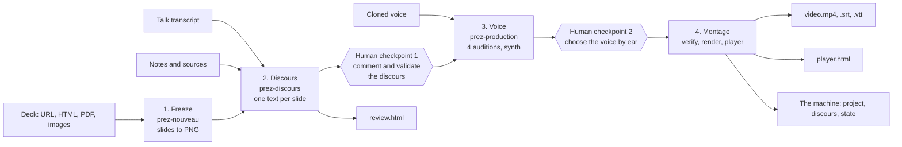

# prez-audio

Turn a slide deck into a narrated video with a cloned voice. Claude Code writes the script and drives the pipeline through three skills; a Python engine (`prez`) does the deterministic work: freeze the slides, call the speech APIs, assemble the video with ffmpeg.

Inspired by a LinkedIn post describing the same machine: a talk's deck, narrated by a cloned ElevenLabs voice, produced by Claude Code with three skills, an engine and tests. This repository is an independent open-source reimplementation of that idea, not the original code.

**Demo:** [docs/demo/demo-kokoro.mp4](docs/demo/demo-kokoro.mp4). The 6-slide deck in `examples/demo-deck/` was narrated by the local Kokoro voice and produced end to end by `prez`, with no manual editing. Subtitles are in [`.srt`](docs/demo/demo-kokoro.srt), and the player page is [`docs/demo/player.html`](docs/demo/player.html): download it next to the mp4.

## En bref

`prez-audio` transforme une présentation (deck HTML, PDF ou images) en vidéo narrée avec ta voix clonée ElevenLabs. Trois skills Claude Code (`prez-nouveau`, `prez-discours`, `prez-production`) pilotent un moteur Python, `prez`. L'humain n'intervient qu'à quelques points : valider le plan, fournir la clé API, commenter le discours slide par slide sur une page claude.ai, choisir la voix à l'oreille parmi 4 versions de la slide 1, dire « continue ».

Règle centrale : on corrige une phrase dans le discours, jamais dans la vidéo. Chaque artefact porte l'empreinte de ses entrées ; seules les slides modifiées sont régénérées. Livrables : la vidéo, le player, la page de review, et la machine elle-même (le projet, rejouable).

Démarrage rapide : voir [Quickstart](#quickstart). Démo hors ligne sans clé API : `examples/demo-deck/` avec le backend `fake`.

## Pipeline



The audition runs before the full synthesis, so checkpoint 2 comes before any credit is spent on the whole deck.

## Quickstart

### Install

Requires Python 3.11+ and [uv](https://docs.astral.sh/uv/).

```
git clone https://github.com/Igosuki/prez-audio && cd prez-audio
uv sync
uv run playwright install chromium
uv run prez --help
```

To get `prez` on your PATH without cloning: `uv tool install git+https://github.com/Igosuki/prez-audio`, then `uv tool run --from git+https://github.com/Igosuki/prez-audio playwright install chromium`.

As a Claude Code plugin:

```
/plugin marketplace add Igosuki/prez-audio
/plugin install prez-audio@prez-audio
```

### Offline demo (fake backend, no API key)

From the checkout:

```
uv run prez new demo --deck examples/demo-deck/index.html --title "Demo" --backend fake
uv run prez -C demo freeze
mkdir -p demo/discours && cp examples/demo-deck/discours/*.md demo/discours/
uv run prez -C demo validate all
uv run prez -C demo synth
uv run prez -C demo render
uv run prez -C demo player       # open demo/out/player.html
```

Then edit one sentence in `demo/discours/slide-03.md` and run `status`, `synth` and `render` again: `synth` refuses until you `validate 3`, and afterwards only slide 3 is re-voiced and re-clipped.

The fake backend produces a quiet tone at about 0.35 s per word. It exercises the whole pipeline, including fingerprints and partial rebuilds.

### Local demo with a real voice (Kokoro, free, no API key)

The `kokoro` backend runs the open Kokoro-82M model locally through ONNX Runtime (French voice `ff_siwis`, English `af_heart`). It needs no system packages. The first synth downloads about 120 MB (int8 model plus voices) to `~/.cache/prez-audio/kokoro/` (`$XDG_CACHE_HOME` is honoured).

```
uv sync --extra kokoro
uv run prez new demo --deck examples/demo-deck/index.html --title "Demo" --lang fr --backend kokoro
```

Then follow the same steps as the offline demo. `prez voice set voice_id=<kokoro voice>` picks another voice; `prez audition` compares four speeds (0.9 to 1.2) instead of stability/style, and `prez voice choose K` writes the speed. Kokoro ignores stability, style and neighbouring-slide context.

### Real run with ElevenLabs

1. Clone your voice in ElevenLabs and note its `voice_id`.
2. Store the key: `export ELEVENLABS_API_KEY=...` or `prez key set` (OS keyring; `prez key check` confirms without printing it). It is never written to the project.
3. In Claude Code, with the plugin installed, ask: "Narrate my deck at <URL>". The skills take it from there:
   - `prez-nouveau` creates the project and freezes the slides.
   - `prez-discours` writes the script and publishes the review page.
   - `prez-production` runs the audition, synthesis, verification, render and player.

You can also run every step by hand with the `prez` commands below.

## The three skills

| Skill | Does | Human step |
|---|---|---|
| `prez-nouveau` | Creates the project from a deck, gathers transcript, notes and sources, sets the voice and key, freezes slides to PNG | Confirms the slide count |
| `prez-discours` | Writes one spoken text per slide from transcript, notes and slide images; publishes the review page; applies comments | Comments card by card; says when it is validated |
| `prez-production` | Auditions 4 voice variants, synthesizes, verifies, renders, builds the player, redoes edited slides | Chooses the voice by ear |

## Commands

```
prez new <dir> --deck <src> [--title T] [--lang fr] [--backend elevenlabs|kokoro|fake]
prez freeze [--exclude 40-42]
prez status [--json]
prez discours init | text <sel>
prez validate <sel>
prez review-page
prez audition [--slide 1] [--variants 4]
prez voice show | set k=v | choose K
prez synth [<sel>] [--force]
prez verify [<sel>]
prez render [--force] [--burn-subs]
prez player
prez key set
```

Slide selectors: `3`, `3,5`, `3-7`, `all`. Run from inside a project or with `-C <dir>`. See [DESIGN.md](DESIGN.md) for details.

## Project layout

```
<project>/
  prez.toml          config
  sources/           transcript, notes, figures
  deck/              frozen copy of an HTML deck
  slides/            slide-NN.png and manifest.json
  discours/          slide-NN.md, the source of truth
  state/             validated.json, voice.json
  audition/          voice variants (ignored by git)
  audio/             TTS output and metadata (ignored)
  build/clips/       per-slide clips (ignored)
  out/               video, subtitles, chapters, player, review page (ignored)
```

The project is meant to live in a git repository. The discours, sources, slides and state are committed; generated media is rebuilt.

## Guardrails

The engine enforces these; the skills cannot bypass them.

1. No voice without validated text. `synth` refuses a slide whose text differs from the validated version.
2. No video with a stale voice. `render` refuses unless every slide's audio matches its expected fingerprint.
3. Only modified slides are redone. `synth` and `render` skip slides whose fingerprint matches; `--force` overrides.
4. The deck reads no local file. While freezing, the browser aborts any `file://` request outside the deck's own directory.
5. Only Claude talks to claude.ai. The engine has no claude.ai code; publishing and reading comments go through Claude Code's Artifact tools.

`prez verify` transcribes each slide's audio and compares it to the text. When the speech-to-text API refuses the request (for example a key without that permission), it reports SKIPPED, never a pass.

## Fingerprints

- `text_fp`: hash of the normalized spoken text of a slide.
- `audio_fp`: hash of `text_fp` and the voice parameters (backend, voice, model, stability, similarity, style, speed, speaker boost, language). Neighbor slides are not part of it: editing slide 7 re-voices slide 7 only.
- `clip_fp`: hash of `audio_fp`, the audio file itself, the slide image and the render parameters. Re-voicing a slide with `--force` therefore rebuilds its clip.

Changing a voice parameter makes every slide stale, which is the intended behavior.

## Requirements

- Python 3.11+, uv
- ffmpeg and ffprobe on PATH
- Playwright Chromium for HTML decks: `uv run playwright install chromium`
- poppler (`pdftoppm`) for PDF decks
- An ElevenLabs account and cloned voice for real runs
- Claude Code, for the skills
- An OS keyring (Secret Service, Keychain, Windows Credential Locker) for `prez key set`; otherwise use `ELEVENLABS_API_KEY`

## Known limits

- Slides are still images. Animations and videos inside the deck are not captured.
- Deck slide detection covers reveal.js, a few common class patterns, a configurable CSS selector, and keyboard navigation as a fallback. Unusual decks may need `deck.selector`.
- Verification needs speech-to-text access on the ElevenLabs key; without it the check is skipped.
- A full render of a long deck takes a long time. Keep the machine awake (`systemd-inhibit` on Linux, `caffeinate` on macOS).
- The voice must be chosen by a person listening; there is no automatic quality judge.
- Voice backends: ElevenLabs (cloned voices, speech-to-text verification), Kokoro (local, free, preset voices, no verification) and the offline fake backend. No other provider is implemented.

## License

MIT, see [LICENSE](LICENSE).
